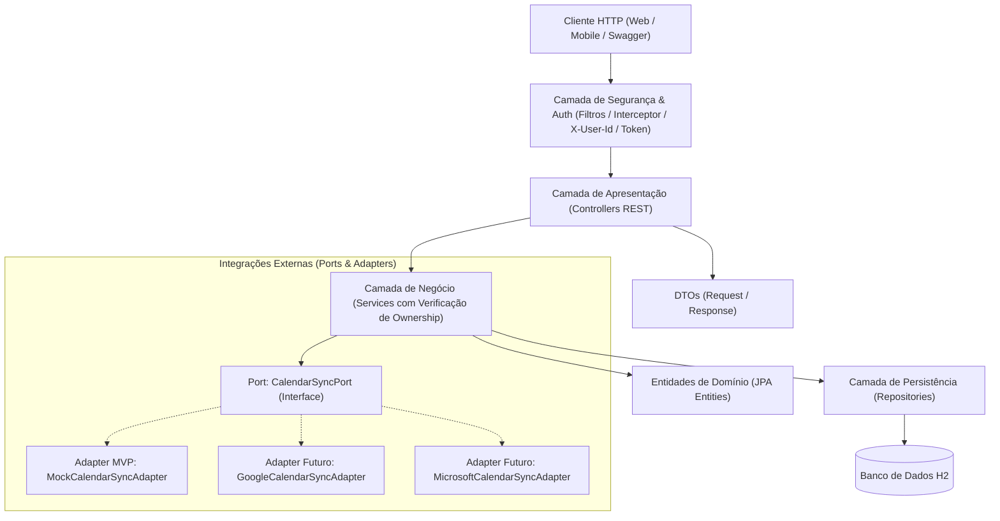

# Arquitetura do Sistema 

Este documento descreve o modelo arquitetural adotado no backend do **Aplicativo de Agendamentos de Serviços com sincronização de calendários externos**, baseado em uma arquitetura em camadas aliada aos princípios de **Ports & Adapters (Arquitetura Hexagonal)** para integrações externas e uma **camada de Segurança e Autenticação simplificada para o MVP**.

---

## 1. Visão Geral da Arquitetura em Camadas

A aplicação adota uma separação estrita de responsabilidades em camadas dentro do ecossistema Spring Boot:



---

## 2. Descrição das Camadas

### 2.1. Camada de Segurança e Autenticação (MVP)
- **Responsabilidade:** Fornecer autenticação simples e determinação de contexto do usuário logado.
- **Login:** Endpoint dedicado `POST /api/auth/login` validando e-mail contra o banco H2.
- **Identificação da Sessão no MVP:**
  - O endpoint de login retorna um DTO contendo o perfil do usuário e um token simplificado (ex.: token estruturado ou representação JWT leve).
  - Requisições subsequentes autenticadas enviam o header `X-User-Id` (ou `Authorization: Bearer <token>`) identificando o usuário ativo.
- **Autorização e Ownership:** A camada de serviço garante que operações sobre agendamentos de clientes (`/api/appointments/me`, cancelamento e reagendamento) sejam restritas ao próprio dono da reserva (`client.id == authenticatedUserId`).

### 2.2. Controllers (Apresentação REST)
- **Responsabilidade:** Receber requisições HTTP, validar payloads de entrada com Bean Validation (`@Valid`), delegar o processamento para os serviços correspondentes e retornar respostas HTTP semânticas (200, 201, 204, etc.) encapsuladas em DTOs.
- **Regras:**
  - Não contém regras de negócio ou validações de domínio complexas.
  - Não injeta repositórios diretamente; comunica-se exclusivamente com a camada de serviço.
  - Documentados com anotações do Swagger/OpenAPI (`@Operation`, `@ApiResponse`, `@Tag`).

### 2.3. Services (Regras de Negócio)
- **Responsabilidade:** Conter e orquestrar todas as regras e lógicas de negócio do domínio (ex.: validação de conflitos de horário, cálculo de horários de término, verificação de disponibilidade, controle de permissão e reagendamentos).
- **Regras:**
  - Gerencia fronteiras transacionais com `@Transactional`.
  - Mapeia entidades para DTOs antes de devolver resultados aos Controllers.
  - Interage com a camada de persistência através de interfaces de repositório.
  - Aciona integrações externas exclusivamente através de abstrações (Ports).

### 2.4. Repositories (Persistência de Dados)
- **Responsabilidade:** Abstrair o acesso e manipulação dos dados relacionais utilizando **Spring Data JPA**.
- **Regras:**
  - Estendem `JpaRepository<Entity, ID>`.
  - Consultas personalizadas devem ser expressas preferencialmente via derived query methods ou anotações `@Query` em JPQL.
  - Isola totalmente detalhes de SQL ou dialetos do banco de dados do restante da aplicação.

---

## 3. Integração com Calendários: Ports & Adapters

Para suportar sincronização com calendários externos (Google Calendar, Microsoft Outlook) sem acoplar a lógica central a provedores de terceiros, adota-se o padrão **Ports & Adapters**:

### 3.1. A Porta (Port)
- Definida como uma interface no domínio de negócio:
  ```java
  public interface CalendarSyncPort {
      String createEvent(Appointment appointment);
      void updateEvent(String externalEventId, Appointment appointment);
      void deleteEvent(String externalEventId);
  }
  ```

### 3.2. Os Adaptadores (Adapters)
- **Fase MVP (Mock Adapter):**
  - Implementação `MockCalendarSyncAdapter` (ou `InMemoryCalendarSyncAdapter`).
  - Simula a criação, atualização e remoção de eventos no calendário externo com logs estruturados e geração de IDs fictícios de sincronização.
  - Permite rodar o projeto localmente e executar testes automatizados sem necessidade de credenciais de OAuth2 ou conexão com APIs externas.
- **Fases Futuras (Provedores Reais):**
  - `GoogleCalendarSyncAdapter`: Integração via Google Calendar API v3.
  - `MicrosoftCalendarSyncAdapter`: Integração via Microsoft Graph API.
  - A troca ou seleção do provedor pode ser feita via `@Profile` ou configuração no `application.yml` sem alterar uma única linha dos serviços de negócio.

---

## 4. Estrutura de Pacotes Sugerida

```text
src/main/java/com/app/scheduling/
├── config/                  # Configurações do Spring (OpenAPI, CORS, Beans)
├── controller/              # REST Controllers (Appointment, Service, User, Auth)
├── dto/                     # Records / DTOs de entrada e saída
│   ├── request/             # CreateAppointmentRequest, RescheduleAppointmentRequest, LoginRequest
│   └── response/            # AppointmentResponse, ServiceResponse, LoginResponse, UserSummaryResponse
├── exception/               # GlobalExceptionHandler, AccessDeniedException, ScheduleConflictException
├── model/                   # Entidades JPA (User, Service, Appointment)
├── repository/              # Interfaces Spring Data JPA
├── service/                 # Interfaces e Implementações de Serviços (AppointmentService, AuthService, UserService)
└── integration/             # Ports & Adapters para calendários
    ├── port/                # CalendarSyncPort
    └── adapter/             # MockCalendarSyncAdapter, etc.
```
