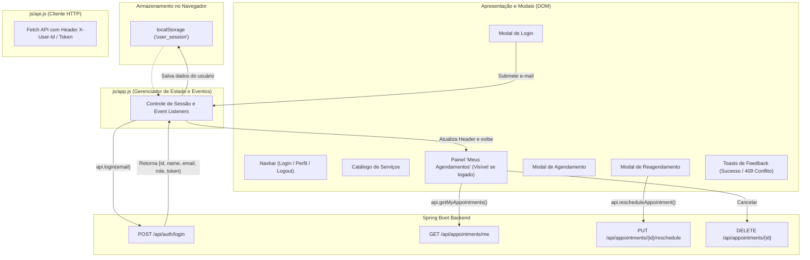

# Arquitetura do Front-end (Frontend Architecture)

Este documento estabelece a organização estrutural, separação de responsabilidades e padrões de fluxo de dados para a interface web do **Aplicativo de Agendamentos de Serviços**, incluindo a **camada de Autenticação do Cliente e Gestão de Sessão via `localStorage`**.

---

## 1. Estrutura de Diretórios

O projeto frontend adota uma organização modular simples e intuitiva, mantendo arquivos estáticos organizados por tipo:

```text
frontend/ (ou raiz / src/main/resources/static/)
├── index.html              # Ponto de entrada único da aplicação (SPA com Dashboard)
├── css/
│   └── styles.css          # Sobrescritas do Bootstrap, tokens de cores e componentes
├── js/
│   ├── api.js              # Camada de integração HTTP com o backend REST e envio de auth headers
│   └── app.js              # Controlador da interface, sessão local, manipulação do DOM e eventos
└── assets/
    ├── img/                # Imagens, logotipos e ilustrações
    └── icons/              # Favicon e ícones locais
```

---

## 2. Separação de Responsabilidades e Fluxo de Autenticação



### 2.1. Gestão de Estado de Sessão (`localStorage`)
- **Chave de Armazenamento:** `user_session` (ou `user`).
- **Estrutura Armazenada:**
  ```json
  {
    "id": 3,
    "name": "Mariana Souza",
    "email": "mariana.souza@email.com",
    "role": "CLIENT",
    "token": "mvp-token-..."
  }
  ```
- **Inicialização da Aplicação:** Ao carregar a página, `js/app.js` verifica se há um usuário salvo no `localStorage`.
  - **Se logado:** Exibe saudação "Olá, [Nome]" e botão "Sair" no Header, e renderiza automaticamente a seção **"Meus Agendamentos"**.
  - **Se não logado:** Exibe o botão "Entrar" na Navbar e oculta o painel de agendamentos pessoais.

### 2.2. `js/api.js` (Camada de Integração com API)
- **Responsabilidade única:** Centralizar chamadas HTTP via `Fetch API`, enviando automaticamente o header `X-User-Id` e token de autorização quando o usuário estiver autenticado.
- **Configuração da Base URL:**
  ```javascript
  export const API_BASE_URL = window.location.origin.includes('8080') 
    ? '' 
    : 'http://localhost:8080';
  ```
- **Endpoints Chave:**
  - `login(email)`: `POST /api/auth/login`
  - `getServices()`: `GET /api/services`
  - `createAppointment(data)`: `POST /api/appointments`
  - `getMyAppointments()`: `GET /api/appointments/me` (com header `X-User-Id`)
  - `rescheduleAppointment(id, data)`: `PUT /api/appointments/{id}/reschedule`
  - `cancelAppointment(id)`: `DELETE /api/appointments/{id}`

### 2.3. `js/app.js` (Controlador da Interface e Eventos)
- Controla abertura/fechamento dos modais (`#loginModal`, `#bookingModal`, `#rescheduleModal`).
- Trata respostas de erro (401 para login inválido, 403 para permissão negada, 409 para conflito de agenda no reagendamento).
- Dispara feedback visual nos Toasts flutuantes.
